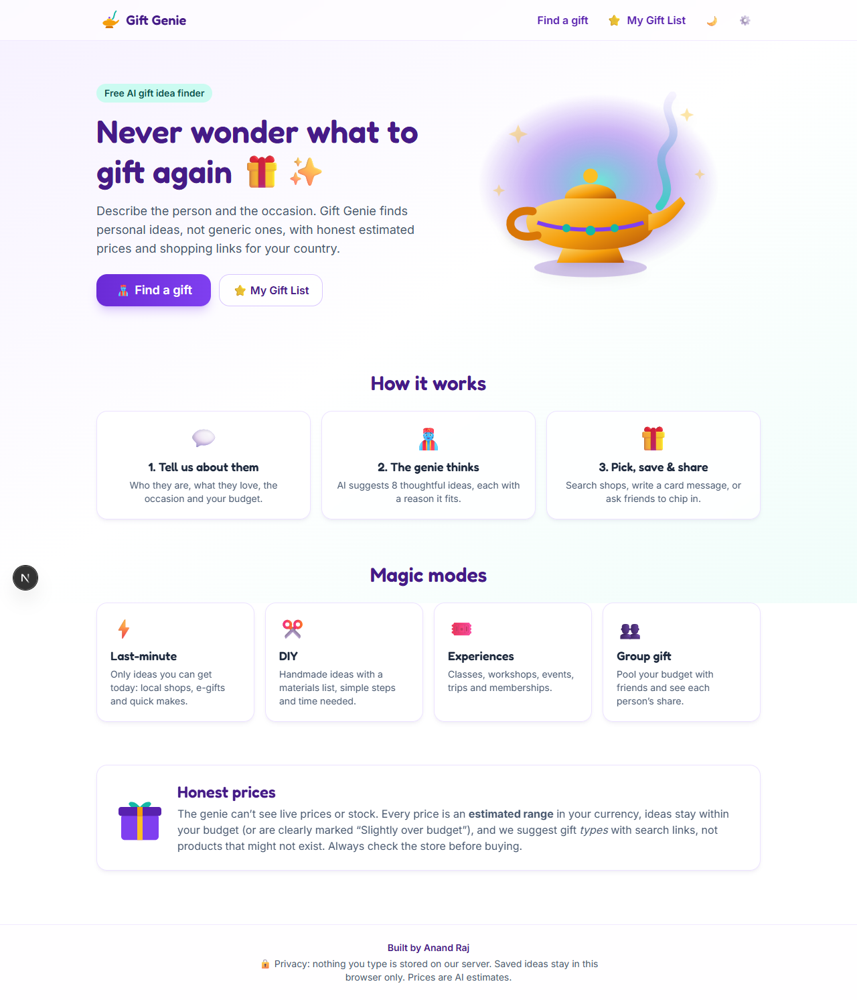
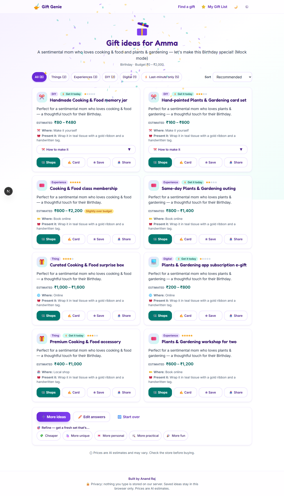

# 🧞 Gift Genie — AI Gift Idea Finder

Never wonder what to gift again 🎁✨. Describe the person, the occasion and your budget, and
Gift Genie suggests 8 personal gift ideas, each with a reason it fits, an estimated price,
shopping search links for your country, DIY steps, experience ideas, group-gift splitting and
card messages in English, Tamil or Hindi. It uses **free AI models only**.

 <!-- screenshot placeholder -->
 <!-- screenshot placeholder -->

## Features
- 9-step wizard (country, who, age, interests, occasion, budget, modes, card language, review),
  remembered in your browser.
- All countries, local currency formatting, budget presets for common currencies.
- Modes: ⚡ Last-minute, ✂️ DIY, 🎟️ Experiences, 🚫 Avoid box, 👥 Group gift (2–30 people).
- Results: gift-box reveal + confetti, filters, sorting, DIY details, per-person share,
  shop search links (Amazon / Flipkart / Etsy + Google Shopping), WhatsApp sharing.
- On demand: ✍️ card messages (5 tones × 3 languages), ➕ More ideas, 🎯 Refine.
- ⭐ My Gift List + 📅 Upcoming occasions (stored only in your browser).
- Dark mode, mobile-first (360px and up), keyboard and screen-reader friendly, reduced-motion aware.

## Honest pricing
The AI can't see live prices or stock. Every price is an **estimated range** in your
currency. Ideas are checked in code against your budget, and anything above it is marked
"Slightly over budget". We suggest gift *types* with a search phrase, not specific products.
Always check the store before buying. Search links are plain links, not affiliate links.

## Privacy
Nothing you type is stored on the server, and user inputs are never logged. Server logs
record only the provider, HTTP status, error type and retry-after. Saved ideas, reminders and
your optional personal Gemini key live only in your browser's localStorage.

## Setup (Windows, beginner-friendly)
1. Install **Node.js 20.9+** (LTS) from <https://nodejs.org>.
2. Open this folder in VS Code → **Terminal → New Terminal**.
3. Install packages: `npm install`
   (if PowerShell blocks scripts, type `npm.cmd install` instead, and use `npm.cmd` for every command below).
4. Add your keys to `.env.local` (see below).
5. Start: `npm run dev` → open <http://localhost:3000>.

### Getting free API keys
- **Gemini (main AI):** go to <https://aistudio.google.com/apikey>, sign in with Google, click
  **Create API key**, and copy it.
- **Groq (backup AI):** go to <https://console.groq.com/keys>, sign up, click **Create API Key**,
  and copy it.

### Environment variables (`.env.local`)
| Variable | Meaning |
| --- | --- |
| `GEMINI_API_KEY` | Your Gemini key (primary model). |
| `GROQ_API_KEY` | Your Groq key (fallback model). One of the two is enough; both is best. |
| `MOCK_AI` | `true` = canned test ideas, no AI quota used (development only; ignored in production). |

`.env.local` is git-ignored. Never commit real keys. `.env.example` shows the format.

Model IDs and limits live in one file: [`src/config/ai.ts`](src/config/ai.ts).

## How the AI calls work
- One click = one AI request chain. Card messages, more ideas and refinements are separate,
  on-demand calls.
- The order is Gemini first. On a per-minute limit with a short retry-after (≤10 s), it waits
  and retries once. On server errors, timeouts (30 s), the daily quota, or invalid JSON after
  one corrective retry, it switches to Groq. Groq requests are sized to fit its free
  tokens-per-minute limit.
- All AI output is validated with Zod, then checked again in code (budget, last-minute,
  avoid list, child safety).
- The per-IP rate limit is 40 AI calls per hour. **Note:** this limit (and the Groq token
  window) is in-memory, so it is best-effort on serverless platforms, where each instance
  counts separately.
- Bring your own key: users can paste their own free Gemini key in ⚙️ Settings. It is sent
  per request in a header and never stored or logged on the server.
- Requests are small text-only JSON (limited to 16 KB, well under Vercel's ~4.5 MB limit).

## Scripts
| Command | What it does |
| --- | --- |
| `npm run dev` | Start the dev server at http://localhost:3000 |
| `npm run typecheck` | TypeScript check |
| `npm run lint` | ESLint |
| `npm test` | Vitest unit tests |
| `npm run build` | Production build |
| `npm run check` | All of the above |

## Deploy to Vercel (free Hobby plan)
1. Push this project to a GitHub repository (`.env.local` is ignored automatically).
2. On <https://vercel.com> → **Add New → Project** → import the repository.
3. In **Settings → Environment Variables**, add `GEMINI_API_KEY` and `GROQ_API_KEY`
   (don't add `MOCK_AI`).
4. Click **Deploy**. AI routes use `maxDuration = 60`, which the Hobby plan allows.

## Tech
Next.js (App Router) · TypeScript (strict) · Tailwind CSS · Framer Motion · Zod ·
canvas-confetti · Vitest · Google Gen AI SDK · Groq API.

Built by Anand Raj.
